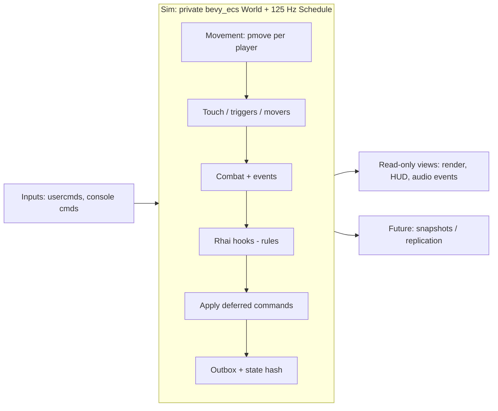

# ECS and scripting design: how `bevy_ecs` and Rhai fit together

Status: **proposal for decision** (design only; no code changes accompany this document).
Scope: `rust/qf-engine` (GPU- and window-free), with notes on `qf-client` and `qf-audio`.
Baseline: `master` at the time of writing (Bomb and Defuse host, map-entity ECS, `pmove`).

## 1. What `ENGINE_PORT.md` actually intends

| Topic | Statement | Consequence |
| --- | --- | --- |
| Entity model | "`bevy_ecs` behind engine-owned game-facing interfaces." Repeated in *Target architecture*: keep it "so gameplay rules and content do not become coupled to Bevy's application framework". | ECS is the **entity model** of the simulation, not an implementation detail of triggers. Bevy types stay private; the public API is engine-owned. Not the full Bevy framework. |
| Scripting | "Rhai for embedded, Rust-like gameplay and map scripts"; "Rhai-based gametypes and map hooks"; "Port required map and gameplay behavior to internal Rhai scripts incrementally". | Rhai expresses **rules** (gametypes, map hooks). It is internal; user modding is deferred. |
| First slice | Scripting "only where the chosen map or gameplay behavior requires it; core movement and collision should remain testable without running scripts". | `pmove`/collision never depend on Rhai. |
| Tick | Fixed **125 Hz**, independent of render and snapshot rate; same shared movement for local play, server authority and prediction. | One schedule definition usable by server and prediction. |
| Determinism | Identical inputs give identical results across Windows/Linux/macOS; the movement regression suite is preserved. | No nondeterministic iteration, time or RNG anywhere in the simulation, scripts included. |
| Networking | Authoritative dedicated server; client predicts own movement and reconciles; protocol isolated behind an interface; Bomb and Defuse first. | Rules run on the server. State must be snapshot-able and inputs must be data. |
| Complexity | "Compare real profiling results before adding complexity solely for a hypothetical performance gain." | Prefer the simplest design that meets the above; measure before optimising. |

Not stated (open): how Rhai binds to the ECS, whether rules are hooks or systems, the schedule
shape, and snapshot/rollback mechanics. This document proposes those.

## 2. Where the current code diverges

`qf-engine` already depends on `bevy_ecs` (0.20, `default-features = false`), so the divergence is
about *how* it is used.

| # | Area | Today | Gap vs. intent |
| --- | --- | --- | --- |
| 1 | Two parallel models | `game::GameHost` holds `Arc<Mutex<Core>>` with `Vec<Player>` (plain structs, `game/combat.rs`) and map entities exported as a Rhai `Array` of `Map`s. `simulation::entities::MapEntities` separately owns a private `bevy_ecs::World`. They share no state. | No single entity model. Rules cannot see or affect ECS entities (`BOMB_AND_DEFUSE.md`: "`bevy_ecs` is not used"). |
| 2 | ECS used imperatively | `MapEntities` is a facade over a `World`; `think`, `step_movers`, `touch`, `activate` call free functions (`logic.rs`, `movers.rs`) with `&mut World`. No `Schedule`, systems, `SystemSet`s or events. Ordering is hand-written in `ModeSimulation::advance` (`walk.rs`). | The ECS is a keyed store, not a scheduled simulation. |
| 3 | Gametype bypasses triggers/movers | `bomb.rhai` rescans the entity lump by classname, re-implements capture-area AABB overlap and fires `target_explosion`/`func_explosive` itself (`scan_map`, `explode`) instead of `MapEntities::activate`. | Duplicated rules; two sources of truth for entity behaviour. |
| 4 | Gametype filter not wired | The client spawns `MapEntities::spawn` (free-for-all filter) beside the bomb host; `Gametype::bomb()` exists but is unused there. | Entity spawn filtering and the gametype are unrelated. |
| 5 | Single local player | `ModeSimulation` owns one `MovementMode`; the `Player` resource is `Option<PlayerPresence>`; other players are caller-supplied `Occupant`s. `GameHost` players are pushed in by `set_player_motion`; the host never runs `pmove`. | Not a multi-player world; no per-player usercmd component, so authority/prediction cannot reuse it. |
| 6 | Two clocks | Host `now` (ms, `tick()` adds 8) vs. entity `level.time = ticks * 8` in `ModeSimulation`. | One `Tick` resource. |
| 7 | `pmove` integration | `pmove` is good: a function of `(world, rules, &mut PmoveState, &PmoveCommand)`; `WalkPlayer::step_with_touch` builds the command. But triggers mutate state *during* the move through `PmoveTouch` (jump pads, teleports), and `movement_locked` is a global bool the client polls (`bomb.rs::apply_movement_lock`). | The touch seam is where ECS and `pmove` interleave (section 5.3). Lock should be a component consumed by the input stage. |
| 8 | Movers vs. scripts | `step_movers` only runs in `ModeSimulation`; script `trace`/`los` use `OwnedBspWorld` (static world), not `MoverWorld`. | Scripts and players see different collision worlds. |
| 9 | Events | Three streams: `PredictedEvent` (pmove), `TriggerEvent` (typed), `GameEvent` (string kind + `BTreeMap<String, Value>`). The client `println!`s bomb events; `SpeakerSet` re-parses the lump separately (`sound.rs`, `game_sound.rs`). | No unified typed event channel for audio/HUD/network. |
| 10 | HUD pull | The client calls the script `hud` hook every frame with mutable host access. | Presentation should read state, not run rules; impossible over a network. |
| 11 | Sandbox/perf | `Engine::new()` (standard packages, which include wall-clock `timestamp`), only `set_max_expr_depths`; no operation, string, array, map or call-depth limits; `g.entities()` clones the whole array per call; each API call locks a `Mutex`; players are `i64` indices. | Not safe for a server, unbudgeted, and a script reading a clock would break determinism. |
| 12 | RNG | One host `Rng`; entity logic avoids randomness (documented deviations: first target instead of `G_PickTarget`, no `target_delay` jitter). | Needs one shared, reorder-safe RNG resource to restore legacy randomness deterministically. |
| 13 | Determinism hygiene (good) | `BTreeMap`/`BTreeSet`; `find_by_targetname` sorts by lump index; no wall clock in the host. | Keep and generalise: bevy query order is not a stable contract. |

Already right and kept: `pmove` as a shared function and its CSV trace harness
(`tests/pmove_traces.rs`); engine-owned facade types with no Bevy types in the public API; a
GPU/window-free crate; device-free sound requests (`sound.rs`); `BTreeMap` discipline; the
headless Bomb tests (`tests/bomb_synthetic.rs`, `tests/bomb_wbomb1.rs`, `tests/game_host.rs`).

## 3. Target architecture (recommended: Option B, section 4)

One engine-owned simulation, `Sim`, wraps a **private** `bevy_ecs::World` and a fixed `Schedule`.
Everything that affects match outcome is an ECS entity, component or resource. Rhai is the
**rules layer**: event hooks plus a per-tick hook, operating through an engine-owned API; it
never receives Bevy types.

### 3.1 Ids and public interface

- Scripts, tests, client and (later) network never see `bevy_ecs::Entity`. Every simulated thing
  has `Id(u32)`: map entities use their **lump index** (matches legacy edict numbers and existing
  event fields), players use their **slot**, runtime entities (bomb, projectiles) draw from a
  deterministic counter resource.
- Public API (names indicative): `Sim::new(SimConfig{seed, map, gametype})`,
  `push_input(slot, UserCmd)`, `push_command(slot, name, args)`, `tick()`,
  `drain_events() -> Vec<SimEvent>`, `view() -> SimView` (read-only), `state_hash()`,
  later `snapshot()/restore()`.
- `MapEntities`, `ModeSimulation` and `GameHost` become thin adapters over `Sim` during
  migration and are removed at the end.

### 3.2 Entities, components, resources, events

| Concept | ECS representation |
| --- | --- |
| Map entities | Keep `LumpIndex`, `Classname`, `Links`, `Placement`, `Volume`, `Timing`, `Enabled`, `TouchKind`, `UseKind`, `Think` (`entities/components.rs`). Add `Props(Arc<BTreeMap<String,String>>)` (raw key/values, shared, read-only) for script access. |
| Players | Entity per slot: `Id`, `PlayerSlot`, `Team`, `UserCmd`, `PmoveState` (reuse), `Health`, `Armor`, `Alive`, `Loadout`, `Stats(BTreeMap)`, `MovementLock`, `SpawnProtection`. Noclip stays a dev-only movement mode via a marker. |
| Movers | `Mover` component (kind, state machine) split from `movers.rs`; `MoverPose` is the read-only pose that views and `MoverWorld` read. |
| Triggers | Existing touch/use components; `target_*` actions run from queued `Use` requests (3.4). |
| Bomb | Entities rather than a script map: `Bomb { state, site, carrier, armed_at, .. }` with origin/velocity for the toss; `BombSite` on the capture-area entities. Rules stay in Rhai; state lives where the engine can snapshot it (or in `ScriptState` during migration, 6.5). |
| Timers | `Timer { due_tick, kind }` (generalises `Think`) plus a `Tick` resource. Script timers (`g.after(ticks, "cb", payload)`) create timer entities so they are snapshotted and replayable. No wall-clock time; level time = `tick * 8`. |
| Resources | `Tick`, `Level` (existing), `Rules` (gametype config), `SimRng`, `Registry` (existing), `Outbox`, `ScriptState`, `Collision(Arc<dyn PmoveWorld>)`, `Models(Arc<dyn BrushModels>)`. |
| Events | Engine-owned `SimEvent` enum, a superset of `TriggerEvent`, `PredictedEvent` and today's `GameEvent`: `Pmove`, `Trigger`, `Damage`, `Death`, `Spawn`, `Script{name, ordered fields}`, `ScriptFault`. Bevy messages may be used internally; the public type is ours. |

### 3.3 The fixed 125 Hz schedule

One `Schedule` run once per 8 ms tick by `Sim::tick()`. The wall-clock accumulator stays in the
caller (`ModeSimulation` today, client/server loop later), never inside systems.

- **Single-threaded executor** and explicit `.chain()` ordering of sets. Parallelism is a later
  optimisation gated by a bit-exact hash test.
- **No iteration-order dependence.** Query order depends on archetype/spawn layout and is not a
  contract. Order-sensitive systems iterate sorted views (players by slot; map entities by lump
  index, as `find_by_targetname` does). A test shuffles spawn order and asserts an unchanged hash.
- **No `HashMap`/`HashSet`** in sim state or script-visible data.
- **RNG:** `SimRng` seeded from the match seed; named substreams (`rng.stream(tick, purpose)`)
  so adding or reordering systems does not shift unrelated randomness. `g.rand` uses a `script`
  substream.
- **Floating point:** `f32` only, no `mul_add`, no platform-varying transcendental calls in sim
  code beyond what `pmove` already uses; verified per platform with the trace harness.

Set order (preserves what `ModeSimulation::advance` already encodes):

1. `Input`: one `UserCmd` per player; apply `MovementLock`; turn console commands into script events.
2. `Movement`: per alive player in slot order, run `pmove` (5.1, 5.3).
3. `Touch`: apply recorded touches: trigger firing, due `Think`s/`Timer`s, `player_touched` buttons.
4. `Movers`: `step_movers` equivalent (carry/push/crush, legacy order).
5. `Combat`: damage requests, deaths, telefrags, hurt volumes.
6. `Rules`: Rhai hooks in queue order, then `tick(g)` (section 6).
7. `Commands`: deferred structural commands (spawn/despawn/teleport) in issue order.
8. `Finish`: flush `Outbox`, advance `Tick`, optional `state_hash`.

Scripts run after physics so they observe this tick's world (what the client effectively does by
ticking the host after walking frames), and all script writes land before the next `Input`.

### 3.4 Trigger/use chains

`use_targets` recursion (`logic.rs`) becomes a queue of `Use { source, target, activator }`
processed in a bounded loop inside `Touch` (high bound, error logged on hit; the legacy game
recurses). Delays use `Timer`s. Firing order stays lump order, and scripts can both emit uses
(`g.use_target(...)`) and receive them (`on_use`).

## 4. Options compared

### Option A: status quo plus a bridge (Rhai owns state, ECS only for map entities)

Keep `GameHost` with plain `Player` structs; add a bridge so scripts can call
`MapEntities::activate` and read mover poses.

- **+** Smallest change; Bomb works and is tested.
- **−** Two worlds and two clocks forever; ECS never becomes the entity model `ENGINE_PORT.md` asks for.
- **−** Snapshot/rollback/replication must serialise Rhai maps *and* an ECS world.
- **−** Multi-player authority and prediction must reinvent player state outside the ECS.

### Option B (recommended): ECS is the source of truth; Rhai is rules via hooks over an engine API

The design of section 3. Hooks keep today's names (`init`, `start_match`, `on_player_joined`,
`on_team_change`, `on_command`, `on_damage`, `tick`, optional `hud`) plus `on_use`, `on_spawn`,
`on_death`, `on_touch`, `on_timer`, `on_reload`. Scripts read/write through typed handles
(`g.player(id).health`, `g.ents("trigger_capture_area")`, `g.damage(..)`) that form the sandbox boundary.

- **+** One world, clock, RNG and event stream; matches "`bevy_ecs` behind engine interfaces, Rhai for rules".
- **+** Snapshot, hash and replication work from a known component list.
- **+** Bomb port is mostly mechanical: most `g.*` names and semantics survive.
- **+** Physics stays in Rust and testable without scripts.
- **−** Real engine work (schedule, players as entities, touch seam).
- **−** Hook-based rules poll in script; no per-component script systems.
- **−** `Dynamic` script state is opaque to the ECS (mitigated by `ScriptState` hashing and gradual promotion to components).

### Option C: Rhai defines components and systems (script-as-ECS)

- **+** "Pure" ECS; parallelisable in principle.
- **−** Large new surface (dynamic components, query DSL, ordering exposed to scripts); hard to
  sandbox, budget and keep deterministic.
- **−** Dynamic components defeat typed snapshots and compact delta networking.
- **−** `ENGINE_PORT.md` says "gametypes and map hooks"; with no user modding initially the flexibility has no consumer.

### Recommendation

**Option B.** It makes `bevy_ecs` the entity model, keeps Rhai as the rules layer as worded in
`ENGINE_PORT.md`, and preserves determinism, replay and networking requirements. Option A is a
valid fallback if the ECS is deliberately limited to map entities (then amend `ENGINE_PORT.md`).
Option C is deferred unless user modding is adopted.

## 5. Movement, determinism and the `pmove` seam

### 5.1 `pmove` stays a pure function

`pmove(world, rules, &mut PmoveState, &PmoveCommand)` is unchanged. `Movement` copies the
player's `PmoveState` out of the component, builds `PmoveCommand` from `UserCmd` (the conversion
in `WalkPlayer::step_with_touch`: axes clamped to `i8`, angles to shorts), calls `pmove`, writes
state and `PmEvent`s back. No Rhai, `World` or ECS types inside `pmove`.

### 5.2 Usercmd components

`UserCmd { forward, right, up, special, view_angles }` is a plain `Copy` component filled by
`Input` from local input, the network (later) or a recording. Tick length is the fixed 8 ms.

### 5.3 The touch seam (the one real design problem)

`pmove_with_touch` calls `PmoveTouch::touch_triggers(&mut state, ..)`, and jump pads/teleporters
change `state` mid-move while mutating trigger timing. Under a schedule that is a borrow problem.

- `Movement` takes a **read-only** trigger view (lump-ordered `Volume`, `TouchKind`, `Enabled`,
  `Timing`) and passes a `TouchRecorder: PmoveTouch` to `pmove`.
- The recorder applies the state-affecting part immediately to the local `PmoveState` (push,
  teleport, hurt result), as `logic::touch` does now, and records `TouchEffect`s (trigger fired,
  `wait` timestamps, targets to use).
- `Touch` applies the effects to the ECS in slot then lump order.
- Approximation to document: with several players, one player's same-tick `wait` update is not
  visible to a later slot's `pmove` unless the recorder updates its local `Timing` view; decide in
  question 5.
- **Parity test:** for one player, ECS `Movement` against the existing `pmove` + `PlayerTouch`
  path on the same usercmd stream must be bit-identical (state and events) before the old path is deleted.

### 5.4 Legacy movement comparison

`tests/pmove_traces.rs` and its CSV fixtures call `pmove` with a `HarnessWorld`; they stay
untouched and remain the exact-invariant/tolerance contract. A second layer adds the parity test
plus an ECS-driven trace (spawn a player entity, feed fixture usercmds through `Sim::tick`) to
prove the schedule does not perturb movement.

## 6. Binding Rhai to the ECS

### 6.1 Hooks, not scripted systems

Engine systems own *mechanics*; the script owns *rules*. During a tick, systems push script
events (spawn, death, damage, use, touch, command, timer) to a queue; `Rules` runs them in push
order, then `tick`. Missing hooks are skipped (as `GameHost::call` does now).

### 6.2 API surface (the sandbox boundary)

- **Handles, not copies:** custom Rhai types (`Player`, `Ent`) wrapping `Id`, with getters/setters
  validated against an **allow-list component registry** (name, type, writable, validator such as
  health clamp or finite-vector check). Scripts cannot name arbitrary or engine-internal
  components (`PmoveState`, `Registry`, `Think`).
- **Queries:** `g.players()`, `g.ents(classname)` return handles in stable order; per-map indices
  are built once and shared (`Arc`), replacing the per-call array clone.
- **Spatial:** `g.trace`, `g.los`, `g.in_world` use `MoverWorld` so scripts and players share collision.
- **Mutation:** field setters and verbs (`g.damage`, `g.spawn_player`, `g.give_weapon`,
  `g.use_target`, `g.after`) apply **immediately and in order** for non-structural changes,
  keeping the read-your-writes semantics Bomb relies on (damage, then read health).
  **Structural** changes (spawn/despawn) go to a command buffer applied after the hook and return
  reserved `Id`s, so handles never dangle mid-hook.
- **Access mechanism:** hooks run in an exclusive system. Rhai needs `'static` values, so `g`
  holds a scoped world pointer valid only during the hook (one audited `unsafe` block, guard
  clears it on exit, re-entrancy check). Safe fallback: `resource_scope` plus a snapshot view with
  a write overlay (per-hook allocation, some API reshaping). Decision in question 2.
- **Events out:** `g.emit(name, #{..})` creates `SimEvent::Script` with ordered fields; a typed
  event list declared in the gametype `config()` lets consumers match names without runtime typos.
- **No ambient authority:** no files, network, `eval`, module resolution or process access.

### 6.3 Sandboxing and performance limits

- `Engine::new_raw()` plus an explicit package list; **no `timestamp`**; `print`/`debug` go to the
  log with tick context.
- Deterministic limits (operation counts, not wall time): `max_operations` per hook and per tick,
  `max_call_levels`, `max_expr_depths` (kept), `max_string_size`, `max_array_size`,
  `max_map_size`, `max_variables`/`max_functions`; `eval` disabled.
- **Fault policy:** a hook that errors or overruns aborts that invocation (earlier writes
  stand), logs tick/hook, emits `SimEvent::ScriptFault`. Dev/test builds fail; the dedicated server
  disables the gametype after N faults and ends the match cleanly.
- **Budgets:** profile per-hook cost; set the operations cap from measurements. A Bomb tick with
  ten players must stay far under the 8 ms budget.
- **Cost hygiene:** reuse the `AST`, pre-resolve hooks, use handles instead of per-tick `Dynamic` maps.

### 6.4 Hot reload

Development only (off for recordings, tests and servers). Recompile, validate required hooks,
swap at a tick boundary, keep `ScriptState` and call `on_reload(g, old_version)` so the script
can migrate it; a failed compile keeps the previous AST. A reload marks an active recording
non-reproducible (script hash in the header no longer matches).

### 6.5 Script state

`this` becomes a `ScriptState(Dynamic)` resource, hashed by canonical ordered serialisation
(ordered maps, floats by bits) and included in snapshots. Rule: values the engine, client or
network must see (bomb/round state, timers, scores) live in **components or typed events**;
private scratch stays in `this`. The Bomb port promotes bomb and site state to components late
(migration step 8), not up front.

## 7. Replay, recording and cross-checks

- **Recording** = header (engine version, map content hash, gametype script hash, seed, tick
  rate) + per-tick input log: `UserCmd` per slot, console commands, join/leave/team changes (everything
  entering `Input`). No state is stored; playback re-runs the sim.
- **Checkpoints:** every N ticks store `state_hash()` over players, bomb, timers, trigger/mover
  state, `ScriptState` and `SimRng` in canonical order; playback asserts each one, so the first
  mismatch pins a determinism bug.
- Existing `replays_are_deterministic` (`tests/bomb_wbomb1.rs`, same-seed event fingerprint) stays,
  joined by a hash-checkpoint equivalent.
- Recording uses the same `UserCmd` to `PmoveCommand` conversion as the trace harness.
- CI replays one recording on Windows/Linux/macOS and compares checkpoint hashes, documenting any tolerance.

## 8. Presentation, audio and networking

### 8.1 Client and audio

- The client owns no rules: per frame it reads `Sim::view()` (player poses, mover poses, HUD values)
  and drains `SimEvent`s.
- **HUD:** replace the per-frame `hud` pull with a per-tick, script-published `HudState` per player
  (ordered `Value` map, like legacy playerstate stats). The client reads it; the same data can be replicated later.
- **Audio:** `sound.rs` keeps mapping events to device-free `SoundEvent`s, now from `SimEvent`
  (including `Script` events, which have no sound path today). `SpeakerSet` becomes speaker
  components or a view-side parse fed by `Use` events. `qf-engine` stays GPU/window/audio-device free.

### 8.2 Future networking and prediction (gated, not built now)

Constraints adopted so they are not precluded:

- Authoritative `Sim` on the server; scripts run there only.
- State lives in a known component/resource list: snapshot, delta against an acked baseline and
  `restore()` work from that list (no reflection). Components are `Clone + PartialEq`.
- `Id`, never `Entity`, appears in events/replication; a later `Replicated` marker selects what is sent.
- Prediction runs a **sub-schedule** (`Input -> Movement -> Touch (predicted) -> Movers`) over
  the client's own player with the same systems as the server, and reconciles by restoring
  predicted components from the last server snapshot and replaying stored usercmds.
  `PredictedEvent` already exists for this.
- 75 ms lag compensation needs per-player pose history (ring-buffer component), deferred.
- Snapshot rate stays independent of the tick; `Sim` knows nothing of transport.

## 9. Migration plan (ordered, small PRs)

Each PR lands green (`cargo test -p qf-engine`, `cargo test -p qf-client`) and keeps the Bomb tests
and same-seed determinism passing unchanged unless stated.

1. **Hardening, no behaviour change.** `Tick` and `SimRng` resources; one clock inside
   `MapEntities`; world state-hash helper; shuffled-spawn-order test.
2. **Schedule for map entities.** Turn `logic`/`movers` free functions into chained single-threaded
   systems (`Touch`, `Movers`, `Finish`); `ModeSimulation` runs the schedule. Existing entity and
   mover tests pass unchanged.
3. **Players as entities.** Player entities, `UserCmd`/`PmoveState` components, `Movement` system
   with the `TouchRecorder` seam; `ModeSimulation` becomes an adapter. Add the bit-exact parity
   test and the ECS-driven trace; `pmove_traces.rs` untouched.
4. **`Sim` interface and unified events.** `Sim`, `SimView`, typed `SimEvent` (with `From` for
   `TriggerEvent`/`PredictedEvent`); client uses `Sim` for movement and sounds.
5. **`GameHost` on `Sim`.** Replace `Core.players` with ECS components; the `Game` handle uses
   scoped world access; same `g.*` names and semantics; `movement_locked` becomes `MovementLock`.
   Bomb tests including `replays_are_deterministic` pass with no script changes. Separately and
   explicitly: spawn with `Gametype::bomb()` (documented behaviour change with a `wbomb1` test).
6. **Sandbox and limits.** `Engine::new_raw()`, operation/size/call limits, no `timestamp`,
   `ScriptFault` and policy, handle types, cached entity indices. Tests: runaway loop aborts
   deterministically, clock functions absent, same-seed hash unchanged.
7. **Collision and use-chain unification.** Script `trace`/`los` through `MoverWorld`;
   `g.use_target`/`on_use`; route `bomb.rhai`'s `target_explosion`/`func_explosive` firing through
   the engine `Use` queue. Synthetic and `wbomb1` scenarios assert event order as today.
8. **Bomb state to components, published HUD.** `Bomb`, `BombSite`, `Timer` components and
   per-tick `HudState`; remove the per-frame `hud` call. `bomb.rhai` changes are limited to using
   handles; the headless scenarios (plant/explode, defuse, timeout, eliminations, role swap, score
   limit) remain the oracle.
9. **Recording/replay.** Input-log recorder/player, checkpoint hashes, a recorded Bomb round
   fixture, cross-platform CI hash check.
10. **Hot reload (dev) and cleanup.** `on_reload` behind a dev flag; delete the adapters and the
    old `GameHost` core; update `BOMB_AND_DEFUSE.md`, `qf-engine/SUMMARY.md` and the entity/scripting
    paragraphs of `ENGINE_PORT.md`.

**Same-seed determinism through 5-8:** each PR first keeps `g.*` behaviour identical so the
`fingerprint(bsp, seed)` event stream is equal before and after. Intended behaviour changes (spawn
filter in 5, RNG substreams, movers in script collision in 7) sit in their own PRs, and golden
fingerprints are re-baselined only there.

## 10. Open questions

1. **Option B vs. A:** is the ECS the single entity model for players and rules state (B), or only
   for map entities (A, then amend `ENGINE_PORT.md`)?
2. **Script access:** accept one audited `unsafe` scoped world pointer for immediate ordered writes
   (recommended), or require a fully safe snapshot-plus-commands design with script adjustments?
3. **Script state:** is an opaque hashed `ScriptState` blob acceptable during migration, or must all
   rule state be components from the start?
4. **Legacy randomness:** reintroduce `G_PickTarget`/`target_delay` jitter via substreams (changes
   golden traces) or keep the documented deterministic deviations?
5. **Touch timing across players:** is the per-slot approximation acceptable, or is legacy ordering
   across players within a tick required?
6. **Server fault policy:** disable the gametype after N faults, end the match, or fail only in dev?
7. **HUD source:** per-tick replicable `HudState` (recommended) or a read-only per-frame hook
   during the single-player phase?
8. **`bevy_ecs` policy:** pin 0.20.x and accept upgrade cost, or add a thin internal layer first?
9. **Recording scope:** internal test/debug tool only, or player-facing (format stability,
   versioning; demo compatibility is "not assumed" in `ENGINE_PORT.md`)?
10. **Map scripts:** include map-specific `.rhai` hooks in the first pass, or after Bomb is ported?
