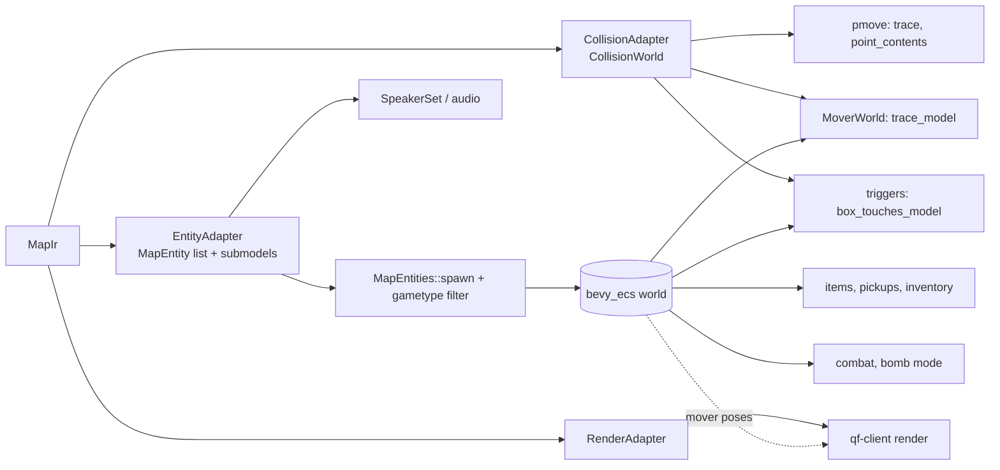

# Map IR: a format-agnostic map representation

Status: design proposal. No code changes accompany this document.

Scope: `rust/qf-engine` (GPU/window-free) and `rust/qf-client`. Related: `ENGINE_PORT.md`, `docs/ECS_AND_SCRIPTING.md`, `docs/WORLD_ASSETS.md`.

## 1. Goals and non-goals

Goals

- Put one format-agnostic **map IR** between map loaders and the engine, so maps and their assets can come from other sources (Q3 IBSP, RBSP, Q1, glTF, OBJ, Quake `.map`, future custom formats) without touching simulation, rendering or game logic.
- Keep FBSP behaviour **bit-identical**: the movement trace harness (`qf-movecmp`, `tests/pmove_bsp.rs`, `tests/movement_compare.rs`), bomb mode tests (`tests/bomb_wbomb1.rs`) and `world-audit` stay green at every step.
- Keep `qf-engine` free of GPU/window dependencies. GPU upload stays in `qf-client`.
- Separate collision, render and entity data so each can be loaded, cached, validated and reloaded independently.

Non-goals

- Replacing the shader script system (`content::shader`) or the VFS. The IR references materials by name; it does not embed shader semantics.
- A new map editor format. Authoring formats are *sources*, converted to the IR.
- Changing the 125 Hz sim, pmove, or ECS entity logic.

## 2. Audit: where the BSP format leaks today

| Area | Where | Leak |
| --- | --- | --- |
| World type | `content::bsp::Bsp` is passed as the "map" to `qf-client` (`main.rs`, `world.rs`, `render.rs`, `headless.rs`, `bomb.rs`, `game_sound.rs`), `game::host` (`Game::from_bsp`, `OwnedBspWorld`), bins (`bsp-inspect`, `entity-survey`, `world-audit`, `qf-movecmp`) and ~100 references in `tests/`. | The raw lump structs (`Face`, `Leaf`, `Node`, `Model`, `ShaderRef`) are public and read directly. |
| Collision | `Bsp::trace`, `trace_model`, `box_touches_model` (`bsp/collision.rs`) walk nodes/leafs/leaf-brushes/brush-sides plus `PatchCollide` facets (`bsp/patch.rs`, `COLLISION_SUBDIVISIONS = 16`). `simulation::bsp_world::BspWorld` adapts it to `PmoveWorld`. | Collision is a BSP-tree walk. `Trace.shader` is an index into the BSP shader lump. Contents/surface bits are the Q3/FBSP numeric values, duplicated as `i32` in `bsp` and `u32` in `pmove.rs` (`CONTENTS_*`, `SURF_*`). |
| Render geometry | `Bsp::model_mesh` builds `WorldMesh`: planar/trisurf faces from `vertices`/`elements`, patches tessellated at `RENDER_SUBDIVISIONS = 5`; flare/foliage faces are skipped. | Face types and patch control grids are lump concepts; `triangle_shaders` indexes `bsp.shaders`. |
| Materials | `qf-client::world` reads `bsp.shaders[r].name` / `.surface_flags`, resolves via `content::shader`, finds the sky via `SURF_SKY`, sizes uniform slots from `bsp.shaders.len()`. | Material identity = BSP shader-lump index. Surface flags also drive rendering (sky, nodraw, nonsolid). |
| Lightmaps | `bsp/lightmap.rs` decodes the lump (128² IBSP / 512² FBSP), builds an atlas, remaps per-vertex UVs via `map_uv(face.lm_texnum, ...)`. Only style 0 is used. | Block layout and `lm_texnum` are format-specific; lightgrid/lightarray unused. |
| Entities | `bsp.parsed_entities: Vec<Entity>` (string key/values) feeds `MapEntities::spawn` (`simulation/entities/spawn.rs`), `NoclipPlayer::spawn` (`info_player_deathmatch`/`info_player_start`), `SpeakerSet::from_entities` (`target_speaker`), `Game::from_bsp`. | The entity lump string format is the entity model; `model "*N"` is parsed in `spawn.rs::volume()`. |
| Submodels / movers | `BrushModels` trait (`entities/mod.rs`, impl for `Bsp`): `model_bounds`, `box_touches_model`, `trace_model(ModelPose)`. Client re-meshes movers with `model_mesh(pose.model)`. `Game::from_bsp` clones `bsp.models`. | Submodel = index into `bsp.models`. Model 0 is the world by convention. |
| Trigger volumes | `trigger_*` spawn uses `model_bounds`; touch tests use `box_touches_model(..., u32::MAX)`. | Relies on trigger brushes having no solid contents (mask-all hack). |
| Spawn selection / gametype | `passes_gametype_filter` (`Gametype`) and `info_player_*` selection read entity key/values (`gametype`, `not_gametype`, `angle`, `origin`). | Mostly format-neutral already, but it lives on `LumpEntity` (`content::bsp::entities::Entity`). |
| Sky | Client: `SURF_SKY` or shader `skyparms` selects the far box. | Surface-flag semantics. |
| Audio | `SpeakerSet::from_entities(&[bsp::entities::Entity])` and `game_sound::new(vfs, &Bsp)`. | Only needs the entity list, but is typed against bsp types. |

Existing seams to build on: `PmoveWorld` (pmove only sees a trace interface), `BrushModels`, `WorldMesh` as a CPU-only mesh, and `Vfs`/`content::shader` that already resolve by name. The leak is mostly *type naming and ownership* (everything takes `&Bsp`), not deep structural coupling.

## 3. IR contents

The IR (`MapIr`) is a plain-data, `Clone + Send + Sync`, serde-able struct made of four **separable** parts plus shared tables. Names are indicative.

```
MapIr {
  header:     MapHeader            // ir_version, units/axes, source provenance, content hash
  materials:  Vec<MaterialRef>     // shared by collision and render
  submodels:  Vec<Submodel>        // index 0 = world; ids shared by all parts
  collision:  CollisionIr
  render:     RenderIr
  lighting:   LightingIr           // optional
  entities:   EntityIr
  vis:        Option<VisIr>        // optional PVS
  assets:     Vec<AssetRef>        // provenance and external dependencies
}
```

**MaterialRef**: `name` (shader/material name, VFS-relative, e.g. `textures/foo/bar`), `contents: ContentFlags`, `surface: SurfaceFlags` (canonical IR flag sets, see §6), optional `source_index` for debugging. Collision brush sides, patches and render surfaces reference materials by `MaterialId`. Replaces `bsp.shaders` indices (`Trace.shader`, `triangle_shaders`).

**Submodel**: `id`, `bounds`, ranges/lists into collision brushes + patches and render surfaces, and a `kind` (world, inline brush model). Entities refer to submodels by `SubmodelId`, never by `"*N"` strings after conversion (the converter keeps the original key for round-tripping).

**CollisionIr** (exact data the trace needs, so FBSP stays bit-identical):

- `planes: Vec<Plane>` (`normal: [f32;3]`, `dist: f32`).
- `brushes` (`first_side`, `num_sides`, `contents`, `material`), `brush_sides` (`plane`, `material`, `surface` override).
- `patches`: patch **control points + control grid size + material**, not only facets. Facets are derived (§4).
- `acceleration`: optional BSP tree (`nodes`, `leafs`, `leaf_brushes`, `leaf_patches`). Present for FBSP/IBSP (imported verbatim); absent for sources that have none, in which case the adapter builds a deterministic tree/grid (§4).
- Optional triangle-mesh collision for non-brush sources (glTF/OBJ) as an alternative `CollisionShape`, flagged non-bit-identical by definition.

**RenderIr** (no GPU types):

- `surfaces: Vec<Surface>`: `kind` (planar, trisurf, patch, flare, foliage/ignored), `material`, `vertex_range`, `index_range` or `patch: {control_grid, size}`, `lightmap: Option<LightmapRef>`, `lod_bounds` (needed so patches in one LOD group subdivide identically), `submodel`.
- `vertices`: `pos`, `normal`, `uv`, `lm_uv` (**surface-local**, i.e. before atlas remap), `color`. Further UV sets and extra lightmap styles are allowed as optional arrays.
- Patches stay as control grids; tessellation is an adapter step (§4).
- No pre-built `WorldMesh` in the IR. `WorldMesh` becomes an adapter output (CPU mesh), as it is today.

**LightingIr** (optional):

- `lightmaps: Vec<LightmapImage>` (size, texel format, `layout` tag) and per-surface `LightmapRef { image, rect }`, so the atlas builder does not need to know block sizes (128/512). Atlas packing stays in the engine adapter (today `LightmapAtlas::build`).
- `lightgrid` (optional, currently undecoded), `lightstyles` (optional), `ambient`/`sun` metadata (`q3map_sun` equivalents) for future use.

**EntityIr**:

- `entities: Vec<MapEntity>` in **file order** (order matters: `G_Find` semantics, spawn order and `targetname` lookups are order dependent). Each entity has ordered `(key, value)` pairs (duplicate keys preserved, matching `Entity::get`, where the **last** matching pair wins; add a regression test) and an optional resolved `brush_model: Option<SubmodelId>`.
- Parsing of game semantics (`classname` handling, `spawnflags`, gametype filter, `target`/`targetname`) stays in the game layer. The IR only carries key/values. This keeps `passes_gametype_filter`, spawn selection and `SpeakerSet` unchanged apart from taking `&[MapEntity]`.
- Sources without an entity lump (glTF, OBJ) either carry entities in sidecar data or via glTF extras/nodes mapped by the converter (see §7).

**VisIr** (optional): clusters, per-leaf cluster/area, PVS bit matrix, area portals. Absent means "everything visible". Nothing in the sim reads it; the client may use it for culling later.

**Header / metadata**: `ir_version`, `source_format` (`fbsp`, `ibsp`, `rbsp`, `q1bsp`, `gltf`, ...), `source_version`, `units` (see below), `up_axis`/`handedness` (canonical: Z-up, right-handed Quake axes), `world_bounds`, `spawn_summary` (cached spawn points, optional), `name`, `author`, `content_hash` of the source bytes, `loader_id` + `loader_version`.

**Coordinate system and units.** The canonical IR is *Quake-native*: right-handed, +X forward, +Y left, +Z up, Warsow/Quake game units (no rescaling), `f32`. Loaders for other conventions (glTF: Y-up, metres) convert at load time with an explicit, recorded transform in the header, never in the engine. Reasoning: pmove, constants such as `DIST_EPSILON = 1/32`, patch tessellation and the whole entity set are tuned in these units, and converting inside the engine would put float rounding into the sim path. Triangle winding is carried as given plus a `winding` field in the header (the client currently renders double sided; see `WORLD_ASSETS.md` follow-ups).

**Provenance and asset refs.** `AssetRef { kind (texture, shader_script, sound, model, skybox), name, referenced_by }` lists every external name the map needs, so `world-audit` can validate without parsing geometry and the cache can be invalidated when dependencies change. Each `MaterialRef` also records `origin: AssetOrigin` (`Vfs(name)`, `Embedded(index)`, `Generated`).

## 4. Determinism contract

The 125 Hz sim and the movement harness depend on exact f32 results. Rules:

1. **Collision input is canonical raw data.** For FBSP/IBSP the converter copies planes, brushes, brush sides, nodes, leafs and patch control points unchanged, in the same order. `Bsp::trace` logic moves (not rewrites) to operate on `CollisionIr`; iteration order and float operations stay identical.
2. **Tessellation/facets stay a single shared implementation.** `patch::build_facets` (collision, `COLLISION_SUBDIVISIONS = 16`) and `tessellate` (render, `RENDER_SUBDIVISIONS = 5`) remain one code path run by the *adapter*, never by converters. The IR stores control points only. The engine adapter derives facets at load time, deterministically, with fixed constants versioned in `MapHeader.collision_version`.
3. **No hash-map iteration, no threading-dependent ordering** in adapters; all vectors keep file order.
4. **Bit-identity is only required for FBSP (and IBSP) sources**, enforced by tests: for each official map, trace the same random sweep set through `Bsp::trace` and the IR trace and compare `to_bits()` on fraction, end position, plane, contents and surface flags. Non-brush sources define their own determinism (same input bytes give the same output bytes) but are not bit-comparable to anything.
5. **Cached IR must be bitwise reproducible**: converter output for the same source + loader version is byte-identical (stable ordering, no timestamps or paths in the payload outside the header). A cached IR is a pure function of (source hash, loader version, IR version).
6. **Entity state hashing** (`entities/hash.rs`, `determinism_tests.rs`) continues to hash ECS state only; the IR content hash goes into recordings (`simulation/recording.rs`) so a replay can detect a different map.

## 5. Separating collision, render and entity data

```
loader --> MapIr --+--> CollisionAdapter  --> impl CollisionWorld  (sim: pmove, movers, triggers)
                   +--> RenderAdapter     --> WorldMesh / lightmap atlas / material table (client)
                   +--> EntityAdapter     --> &[MapEntity] + submodel table (ECS spawn, spawn points, speakers)
```

- The three parts only share `materials` and `submodels` (ids). A headless server or `qf-movecmp` loads `collision + entities + submodels` and never touches `render`/`lighting`. A client-only tool (`bsp-inspect`-style viewers) can skip collision.
- `CollisionWorld` is a new trait that merges today's `PmoveWorld` (static world trace + `point_contents`) and `BrushModels` (`model_bounds`, `box_touches_model`, `trace_model`). `BspWorld` becomes the first implementation; `MoverWorld` keeps wrapping it.
- Collision content flags are the only render-relevant data in collision. Render-relevant flags (sky, nodraw) live in `materials`, resolved once.
- Entities reference submodels by id; submodel resolves to collision (brushes/patches) and render (surfaces) ranges. Movers therefore use the same id for physics and mesh.

## 5b. Downstream consumers

Downstream systems never read `MapIr` directly; each consumes one adapter output.



- **Collision**: `pmove` uses the world trace and `point_contents`; movers wrap it in `MoverWorld` and call `trace_model(SubmodelId, pose, ...)`; triggers use `box_touches_model(SubmodelId, ...)`. Hits report shared contents/surface flags and a `MaterialId`.
- **Entities/ECS**: `EntityAdapter` supplies ordered key/values and an optional `SubmodelId` (replacing `"*N"` parsing in `spawn.rs`). `MapEntities::spawn` applies the gametype filter and builds ECS components; item/weapon/pickup entities (`item_*`, `weapon_*`) and spawn points are ordinary entities. Inventory and combat (not yet in the Rust port) are ECS systems that reach the map only via collision traces and trigger touches. Item models/sounds are `AssetRef`s resolved through the VFS.
- **Render/audio**: the client draws the static world from `RenderAdapter` output and mover submodels at poses read from the ECS; `SpeakerSet` takes the entity list.
- The sim sees only a frozen collision world and entity list, so game logic cannot tell which format a map came from. Entity changes re-run spawn against a new IR revision at a map/revision boundary.

## 6. Contents and surface flags

The IR defines its own `ContentFlags` and `SurfaceFlags` (bitflags, `u32`), with a documented stable numeric layout that **equals today's FBSP values** for the bits the engine uses (`CONTENTS_SOLID=1`, `LAVA=8`, `SLIME=16`, `WATER=32`, `PLAYERCLIP=0x10000`, `BODY=0x2000000`; `SURF_NODAMAGE=1`, `SLICK=2`, `SKY=4`, `LADDER=8`, `NOWALLJUMP=0x80000`, `NONSOLID=0x4000`). Consequences:

- `pmove.rs` consts move into the shared module (single `u32` definition) with no numeric change; this is the first migration PR.
- The FBSP converter is a no-op copy for these bits; other loaders carry an explicit mapping table (e.g. Q1 contents `-1..-14` to IR contents; Q3 IBSP flag differences; RBSP; glTF extras).
- Unknown source bits are preserved in an `extra_bits` field so round trips and debugging are possible, but are masked out of the engine view.

## 7. Materials and assets through the VFS, with pluggable sources

Today everything resolves through `content::vfs` (`*.pk3` alphabetical, later overrides earlier, plus the map pk3) and `content::shader` (scripts, implicit lightmap+diffuse fallback). The IR keeps that contract: a `MaterialRef.name` is a VFS-relative shader/texture name, and resolution is the unchanged `shaders.resolve(name)` followed by image load.

Proposed additions:

```rust
trait AssetSource: Send + Sync {
    fn id(&self) -> &str;                          // "pk3:<name>", "dir:<path>", "gltf:<file>"
    fn read(&self, name: &str) -> Option<Cow<[u8]>>;
    fn list(&self, prefix: &str) -> Vec<String>;   // for shader scripts, wildcard lookups
}
```

- `Vfs` becomes an ordered stack of `AssetSource`s: loose directories (override, for development and hot reload), pk3 (existing behaviour), embedded-in-map sources (glTF buffers/images, map pk3), and future network/package sources. Override order is explicit and recorded in provenance.
- **Embedded materials** (glTF PBR, OBJ+MTL): the converter registers a synthesized material name (e.g. `gltf/<map>/<material>`) and either emits an equivalent shader script text into a per-map `ShaderScript` overlay source or an `AssetRef` to an embedded image exposed by that source. `content::shader` already supports "no script means implicit shader", so the minimum viable path needs only textures. Scripted features (`tcmod`, `rgbgen`) are never required of non-Quake sources.
- **Name normalization** (case, slashes, extension probing `.tga/.jpg/.png/.ktx`) stays in the VFS/image layer, not in loaders.
- **Skyboxes, sounds, models** are referenced as `AssetRef`s; resolution is lazy and shared with `qf-audio` (`game_sound::mount_content`).

## 8. Loader plug-in design and converters

```rust
trait MapLoader {
    fn id(&self) -> &'static str;                      // "fbsp", "ibsp", "rbsp", "q1bsp", "gltf", "obj", "quake-map"
    fn version(&self) -> u32;                          // part of the cache key
    fn sniff(&self, head: &[u8], name: &str) -> Sniff; // magic/extension probe
    fn load(&self, input: MapInput<'_>, ctx: &mut LoadContext) -> Result<MapIr, MapLoadError>;
}

struct LoadContext<'a> {
    vfs: &'a Vfs,                 // for side files (.ent, .map, textures needed to size UVs)
    diagnostics: &'a mut Diagnostics,
    options: LoadOptions,         // which parts to build: collision / render / lighting / vis
}
```

- A `LoaderRegistry` tries loaders by `sniff` order; `qf-engine::content::map::load(vfs, name)` is the single entry point used by `qf-client`, `game::host`, and the bins.
- Loaders are pure functions of input bytes (+ VFS reads for named sidecars, recorded in `assets`). They never run tessellation or build engine structures.
- **First converter: FBSP -> IR**, built from the current `Bsp::parse` (kept as the format reader). Initially `MapIr` wraps/borrows the parsed lumps (see Option A); the converter becomes a real copy in a later PR.
- Next: Q3 IBSP (the code already parses IBSP: `Format::Ibsp`, 17 lumps, 128² lightmaps), RBSP, Q1 BSP (needs palette textures and a clip-hull to brush conversion), glTF (render geometry plus optional collision-proxy meshes, entities from node extras), OBJ and Quake `.map` (brush source; `.map` yields brushes directly, and needs plane-intersection to build render faces; offline step preferred).
- **IR -> engine adapters** (in `qf-engine`, GPU-free):
  - `CollisionAdapter: MapIr -> impl CollisionWorld` (builds patch facets, optional acceleration tree).
  - `RenderAdapter: MapIr -> WorldMesh + LightmapAtlas + MaterialTable` (tessellates patches, packs lightmaps, maps surfaces to material ids). `qf-client::world` consumes these and stays the only GPU code.
  - `EntityAdapter: MapIr -> (Vec<MapEntity>, SubmodelTable)` replaces `parsed_entities`/`models` clones in `Game::from_bsp` and `MapEntities::spawn`.

## 9. Versioning, serialization and caching

- **IR version**: `ir_version` (major.minor). Major bump = incompatible layout; the loader cache is invalidated. Minor = additive optional fields (the format uses explicit field tags or a self-describing length-prefixed container; flags for optional sections).
- **Container**: `QFMIR` magic, header, then independent sections (`MATERIALS`, `SUBMODELS`, `COLLISION`, `RENDER`, `LIGHTING`, `ENTITIES`, `VIS`, `ASSETS`), each with length and checksum. Sections are loadable independently (headless sim skips render and lighting).
- **Cache key** = `(source content hash, loader id, loader version, ir_version, relevant LoadOptions)`; stored under a cache directory next to the game data or in a user cache dir, never written into pk3s. Corrupt or mismatching entries are ignored and regenerated.
- **Serialization choice** is deferred to implementation: `serde` + `bincode`/`postcard` is the simple default; `rkyv` allows zero-copy mmap for large maps. Either way the encoder must be canonical (sorted maps, fixed endianness: little-endian, `f32` bit patterns preserved, no NaN canonicalization).
- Because the cache is a derived artifact, **the source remains authoritative**. A flag `--no-map-cache` forces reparse (used by CI to prove cached and fresh IR give identical trace hashes).

## 9b. Authoring: editing maps and entities from mesh and brush editors

`MapIr` as described above is a **compiled, immutable runtime snapshot**. FBSP (and any compiled BSP) is lossy: it has no brush construction history, texture axes, groups/layers, prefabs or compile settings. Editors therefore need a separate, source-authoritative layer:

```
sources (.map, glTF, editor project, FBSP import)  -->  MapDocument  --compile-->  MapIr  -->  adapters
                                                              ^                       |
                                                              +-- MapEditCommand      +--> export: FBSP (compiled only), glTF, .map
```

- **`MapDocument`** (editable): entities (ordered key/values, duplicates preserved and surfaced in the UI), brushes with ordered `BrushFace { plane, material, texture projection (axes/offset/rotation/scale or UV basis), face flags }`, patches (`PatchDocument`: control grid with per-point position/UV/colour/normal, material, stable point ids), meshes (`MeshDocument`: topology, normals/tangent policy, material slots, optional authored collision proxy), groups/layers, and brush-model ownership (entity -> brush set). Face polygons are derived cache data, not authoritative; the compiler rebuilds them from planes with deterministic rules and rejects open/non-convex/degenerate brushes with diagnostics.
- **Stable identity**: every document object has a persistent opaque id (entity, brush, face, patch, control point/mesh element, material, layer, inline model). Rules are defined for import (ids derived deterministically from source order), duplicate (new ids), delete, merge and export. The compiler emits an `IdMap` (document id -> runtime `MaterialId`/`SubmodelId`/surface/brush ranges); runtime ids stay compact indices and may change between compiles, document ids never do.
- **Editing model**: `MapEditCommand`s applied in transactions to a revisioned document, each with an inverse (or snapshot policy) for undo/redo and a dirty set. Brush/patch edits invalidate that object's collision, render and bounds (and affected acceleration chunks); entity-property edits rebuild entity output only; material edits do not rebuild collision unless contents/surface semantics change.
- **Compile and preview**: each compile yields a new immutable `MapIr` revision (all affected sections swapped together, never mixed across revisions). The sim never sees a swap mid-run in match mode; an editor/freeplay preview mode restarts or pauses the sim at a revision boundary, and recordings store the IR content hash. FBSP export is a *compile target* (BSP tree, vis, lightmaps are a compiler responsibility, possibly an external tool) and not a lossless editor source; `.map` and the editor project format are the lossless sources.
- **Capability contract per format**: each loader/exporter declares `{read_document, write_document, read_compiled, write_compiled}` so tools know what survives a round trip (FBSP: read compiled + optional lossy document recovery from brushes/planes; `.map`: lossless document; glTF: semantic mesh document, collision via proxy or generated brushes).
- **Migration**: the editing layer is *after* the IR stabilises (new step 14 below); the IR design here must not preclude it, hence document ids in `IdMap` and `AssetRef`/`MaterialRef` provenance.

## 10. Validation

A `validate(&MapIr) -> Vec<Diagnostic>` pass runs after every load (and when reading a cache entry):

- Structural: all indices in range (planes, materials, submodels, vertex/index ranges, patch grid sizes via `valid_control_points`), submodel 0 exists, ranges don't overlap incorrectly, each plane normal finite and (near) unit length, brush sides closed/non-empty, entity brush-model refs resolve.
- Numeric: no NaN/inf in positions/planes, world bounds within a sane limit.
- Semantic (warnings): missing spawn points, trigger entities without brush models, materials not resolvable by the VFS (shares logic with `world-audit`), lightmap refs missing images, unsupported surface kinds skipped (counted, like `WorldMesh::skipped_faces`).
- Errors vs warnings: structural errors fail the load; semantic issues are diagnostics (currently `Bsp.diagnostics: Vec<String>`), surfaced by `world-audit` and `bsp-inspect`.
- Pre-existing tolerance is preserved: the FBSP converter must accept every map the current parser accepts, with the same behaviour for malformed leaf/brush data.

## 11. Streaming and hot reload

- **Granularity**: world (single load per match) and **per-section** reload. Collision and entities change only at map change; materials/textures/lightmaps can change while running.
- **Hot reload in the client** (dev only): watcher on loose-directory sources; on change, re-resolve materials (re-run `shader.resolve`, reload textures, rebuild the `RenderAdapter` output) while keeping the same `MapIr` identity. Reloading geometry rebuilds `WorldMesh` and GPU buffers in `qf-client`; collision and entity state are untouched.
- **Sim safety**: the sim never observes reloads. A reload that changes collision or entities is only applied at a match/map boundary (or in a `--dev` freeplay mode that restarts the sim), because replacing collision mid-run would break determinism and recordings. The IR's content hash is checked by recordings/replays.
- **Streaming** (large maps, chunked glTF, async load): `MapIr` sections are independently available (`Arc<CollisionIr>`, `Arc<RenderIr>`), so render can be built progressively while the server loads only collision and entities. True spatial streaming (cells, LOD) is out of scope; the surface/submodel ranges and optional vis leave room for it.

## 12. Options considered

### Option A: thin IR over current structs

`MapIr` is a facade: traits (`CollisionWorld`, `RenderSource`, `EntitySource`, `MaterialTable`) implemented for `Bsp` initially, plus a loader trait returning `Box<dyn MapIr>`/enum. Concrete data structs gradually move out of the BSP module.

- Pros: smallest first PR, zero risk to bit-identity (same code runs), reversible, each consumer migrated one at a time, harness stays green trivially.
- Cons: no real format independence until a second implementation exists; trait objects/generics in hot paths (collision) need care to avoid pmove perf regressions (use generics or `&dyn` only at the world boundary, which `PmoveWorld` already does); no cacheable artifact yet.

### Option B: full canonical IR (data, serialized)

Section 3 as concrete structs; every loader converts to it; adapters work only on IR.

- Pros: clean boundary, cacheable binary, validation in one place, trivial to add loaders, tooling (`bsp-inspect`, `world-audit`) works on any source.
- Cons: biggest change; copies FBSP data (memory/time); the conversion must be proved bit-identical; risk of designing the IR before a second format validates it (over- or under-fitting to Q3 ideas); the largest PR sequence.

### Option C: ECS-asset based

Map pieces are Bevy `Asset`s (`Handle<CollisionAsset>`, `Handle<MeshAsset>`, `Handle<MaterialAsset>`) loaded by `AssetLoader`s; the engine is built around assets and events (`AssetEvent::Modified` gives hot reload).

- Pros: matches `bevy_ecs` direction in `docs/ECS_AND_SCRIPTING.md`, gives hot reload and async loading nearly for free, loaders are the Bevy `AssetLoader` extension point.
- Cons: `qf-engine` uses `bevy_ecs` only, not `bevy_asset` (it pulls `bevy_app`/`bevy_tasks` and a scheduler model); asset lifecycle is async and non-deterministic in timing, which conflicts with the deterministic sim unless the sim consumes only fully loaded, frozen data; the VFS/pk3 stack would need an `AssetReader` bridge; it also is not an IR (it still needs one for the data inside).

### Recommendation

**A, then B incrementally, with C as an optional later wrapper.** First extract the trait seams (A) so consumers stop naming `Bsp`; then introduce concrete IR structs and the FBSP converter behind those traits (B) and flip adapters to the IR one part at a time, proving bit-identity with the trace harness at each step; the binary cache comes after the IR is stable. An asset-system integration (C) can wrap the finished loader/IR as an `AssetLoader` in `qf-client` if hot reload and async load justify the dependency, keeping `qf-engine` GPU/window-free and the sim consuming frozen `Arc<MapIr>`.

## 13. Migration plan (small PRs)

Each PR must keep green: `cargo test -p qf-engine` (including `pmove_bsp`, `movement_compare`, `bomb_wbomb1`, `patch`, `map_entities`), the movement trace harness (`qf-movecmp` comparison against recordings), bomb mode tests in `qf-client`, and `world-audit` over the official maps (same warning/missing counts as `WORLD_ASSETS.md`). A PR adds its own test that would fail if it changed behaviour.

1. **Shared flag types.** Add `content::map::flags` (`ContentFlags`, `SurfaceFlags`) with FBSP values; make `pmove.rs` and `bsp` re-export them. Assert numeric equality in a unit test. No behaviour change.
2. **`CollisionWorld` trait.** Merge `PmoveWorld` + `BrushModels` into it (keep the old names as aliases for one PR); implement for `Bsp`; `BspWorld`/`MoverWorld` consume the trait. Golden trace test: hash of sweeps on official maps recorded before/after.
3. **Entity + submodel source.** Introduce `MapEntity` (+ `SubmodelId`) in `content::map`, convert `bsp::entities::Entity` into it (type alias first); `MapEntities::spawn`, `SpeakerSet`, `NoclipPlayer::spawn`, `Game::from_bsp` take `&[MapEntity]` and a submodel table instead of `&Bsp`.
4. **Material table.** `MaterialId`/`MaterialRef`; `Trace.shader` and `WorldMesh.triangle_shaders` use `MaterialId`; client `world.rs` reads the table instead of `bsp.shaders`; sky detection moves to the table.
5. **`MapIr` structs + FBSP converter** (data copy of collision, render surfaces, materials, entities, submodels). Equivalence tests: IR vs `Bsp` traces, bit-compared over recorded and random sweeps on every official map; `model_mesh` equality.
6. **Collision adapter on IR.** `CollisionWorld` implemented from `CollisionIr` (moved trace code, patch facets derived by the adapter); switch `qf-movecmp`, `pmove_bsp`, `bomb` to it; delete the old impl only after one green release with both available behind a feature flag.
7. **Render adapter on IR.** `WorldMesh` built from `RenderIr` (patch tessellation moved, not rewritten); mover re-mesh by `SubmodelId`; `qf-client` stops importing `Bsp`.
8. **Lightmap abstraction.** `LightingIr` with surface-local UVs and `LightmapRef`; atlas builder takes images instead of lump blocks; supports both 128² and 512² and opens the door to multiple styles.
9. **Validation + diagnostics.** `validate` pass; `world-audit`/`bsp-inspect` run on IR; shared diagnostics type.
10. **Binary container + cache.** Serialization, cache key, `--no-map-cache`; CI check that cached and fresh IR produce identical trace hashes.
11. **Loader trait + registry + `AssetSource`.** `Vfs` as stack of sources; FBSP and IBSP registered through the registry. Remove public `Bsp` fields from non-loader code.
12. **Second-format proof:** Q3 IBSP loader (already parsed today as `Format::Ibsp`; RBSP is currently only detected and rejected, so it is a separate milestone with its own layout work and fixtures), then a glTF/OBJ prototype (render + collision proxy + entities from extras) to validate the IR shape. Quake `.map` / Q1 later.
13. **Hot reload** of materials/textures in the client (dev flag), then optional asset-system wrapper.

14. **`MapDocument` and editing commands** (see §9b): document model, stable ids, brush/patch/mesh compile to `MapIr`, undo/redo, `.map` read/write, then editor preview mode.

## 14. Risks

- **Patch tessellation determinism.** Collision facets (`build_facets`, 16 subdivisions) and render tessellation (5, LOD-group `lod_mins/maxs`, `MAX_FLATNESS`) must stay one shared implementation with the exact current float ops. Mitigation: keep control points in the IR, move code verbatim, hash facets and tessellated meshes of all official maps before/after (step 2/5).
- **Content/surface flag mapping.** Other formats use different bit meanings (Q1 negative contents, Q3 vs Warsow additions such as `NOWALLJUMP`). The trigger `u32::MAX` mask trick and `SURF_NONSOLID` handling in brush loading depend on exact flags. Mitigation: explicit per-source mapping tables with tests; keep `extra_bits`.
- **Lightmap layouts.** 128² IBSP vs 512² FBSP, per-vertex vs per-surface UVs, 4 styles in FBSP (only style 0 used today), overbright (`LIGHT_SCALE`). Mitigation: surface-local UVs + rects in the IR, atlas packing in one place; screenshot comparison on a few maps.
- **Collision acceleration structure.** Non-BSP sources need a tree/grid; its traversal order can change which brush is hit first at equal fractions. Mitigation: define tie-breaking; mark such worlds as outside the bit-identity guarantee.
- **Entity order and string semantics.** Lump order, duplicate keys and case-insensitive classname/targetname matching are relied on (`G_Find`, spawn order, ECS entity ids in hashes).
- **Performance/memory.** Copying large maps; trait dispatch in the pmove hot path. Mitigation: generics at the boundary, `Arc` sharing, benchmark `qf-movecmp`.
- **Scope creep from formats.** Designing for glTF/Q1 before a prototype may distort the IR. Mitigation: build the IR from FBSP/IBSP first, validate with the second-format proof (step 12).
- **Cache staleness.** Wrong key = wrong collision silently. Mitigation: include loader/ir/collision versions and source hash; validation on load; CI check.
- **Recordings.** Existing recordings reference maps by name; add the IR content hash without invalidating old recordings.

## 15. Open questions

0. Editing (new requirement: edit maps and entities from mesh and brush editors): is the lossless source format Quake `.map`, an editor project format, or glTF with extras? Do we write our own FBSP compiler (BSP/vis/lightmaps) or call an external one (q3map2-like)? Which editors must be supported (external such as Trenchbroom/Blender, or an in-engine editor)?

1. Which non-BSP source matters first: Q3 IBSP/RBSP, glTF, OBJ, or Quake `.map`? This decides the second converter and what the IR must prove.
2. Is bit-identical collision required for **all** brush-based sources (IBSP/RBSP) or only FBSP? (This document assumes FBSP and IBSP only.)
3. For triangle-mesh sources (glTF/OBJ), should collision be generated convex brushes (deterministic, pmove-compatible), a triangle-mesh collider (needs new trace code), or supplied explicitly by the author via proxy meshes?
4. Keep Q3/Warsow units and Z-up as the canonical frame (recommended), or define metres/Y-up and convert in the engine?
5. Cache: where should it live and which serialization (`bincode`/`postcard` vs `rkyv` zero-copy)? Are extra dependencies acceptable in `qf-engine`?
6. Is `bevy_asset` an acceptable dependency for the client (Option C), or should hot reload stay a custom watcher?
7. Should hot reload ever change collision/entities in a running sim (dev mode), or only materials/textures?
8. Should embedded materials (glTF PBR) be converted into synthesized shader scripts, or should the renderer gain a native PBR path?
9. Do we keep a long-term public `Bsp` type (tools like `bsp-inspect`), or hide it behind the FBSP loader once the IR exists?
10. Is PVS/vis needed by the client in the near term, or can it stay optional and unused?
